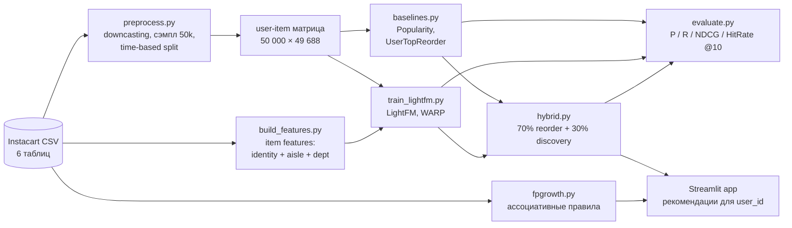

# Рекомендательная система для e-grocery на данных Instacart

Прототип гибридной рекомендательной системы для онлайн-продуктового ритейла: персональные рекомендации, блок «часто покупают вместе» и технико-экономическое обоснование внедрения. Выпускная квалификационная работа.

**Стек:** Python 3.11 · LightFM · mlxtend (FP-Growth) · scipy.sparse · pandas · Streamlit · Docker

**Демо:** [kirillkirov.ru](https://kirillkirov.ru)


---

## Задача и бизнес-контекст

В продуктовом онлайн-магазине каталог насчитывает десятки тысяч позиций, а корзина собирается регулярно — раз в неделю или чаще. Покупателю долго искать привычные товары вручную, магазин теряет конверсию и средний чек.

Персонализация решает две задачи:

1. **Удержание и повторные покупки.** Продуктовый спрос цикличен: в датасете доля повторных покупок (Reorder Rate) около 59 %. Рекомендации «купить снова» сокращают путь до оформления заказа.
2. **Рост корзины.** Блок «часто покупают вместе» (ассоциативные правила) и discovery-рекомендации новых товаров стимулируют кросс-продажи.

Система принимает `user_id` и возвращает top-N товаров, а для выбранного товара показывает сопутствующие.

## Данные

[Instacart Market Basket Analysis](https://www.kaggle.com/c/instacart-market-basket-analysis/data) (Kaggle) — открытый бенчмарк для задачи Next-Basket Recommendation.

| Показатель | Значение |
| --- | --- |
| Заказов | 3 421 083 |
| Строк «заказ–товар» (prior) | 32 434 489 |
| Пользователей | 206 209 |
| Товаров | 49 688 (134 aisle, 21 department) |
| Таблиц | 6 (`orders`, `products`, `aisles`, `departments`, `order_products__prior`, `order_products__train`) |

Для экспериментов взят случайный сэмпл **50 000 пользователей** (`random_state=42`): user-item матрица 50 000 × 49 688, разреженность 99,87 %.

Сырые данные в репозиторий **не входят** (~700 МБ). Скачать:

```bash
pip install kaggle   # нужен API-токен ~/.kaggle/kaggle.json и принятые правила соревнования
kaggle competitions download -c instacart-market-basket-analysis
unzip instacart-market-basket-analysis.zip -d data/raw/
```

В `data/raw/` должны лежать 6 CSV-файлов.

### Что показал EDA

| Заказы по дням недели | День недели × час |
| --- | --- |
|  |  |

- Пик заказов — в выходные и начале недели, основной спрос — с 10 до 16 часов.
- Повторяемость сильно зависит от категории: у dairy eggs, beverages, produce она самая высокая. Поэтому aisle и department использованы как признаки товаров.


## Схема конвейера



**Разбиение train/test — по времени:** в train все исторические заказы пользователя (`eval_set='prior'`), в test его последний заказ (`eval_set='train'`). Так модель не видит будущего.

## Модели

| Модель | Идея |
| --- | --- |
| **Popularity** | Глобальный топ продаж, нижняя граница качества |
| **UserTopReorder** | Самые частые покупки конкретного пользователя |
| **LightFM** | Гибридная факторизация с признаками товаров (aisle, department). WARP loss, 64 компоненты, lr 0.05, 15 эпох |
| **FP-Growth** | Ассоциативные правила X → Y (min_support 0.003, min_confidence 0.1, lift > 1) на 200 000 корзин. Найдено 377 правил, покрыто 99 товаров |
| **Hybrid** | Switching-ансамбль: 70 % слотов — UserTopReorder, 30 % — LightFM без уже купленных товаров (discovery) |

## Метрики

Тест: последний заказ, 5 000 случайных пользователей, K = 10. Результаты воспроизводятся командой `python -m src.evaluate`.

| Модель | Precision@10 | Recall@10 | NDCG@10 | HitRate@10 |
| --- | --- | --- | --- | --- |
| Popularity | 0.072 | 0.072 | 0.099 | 0.460 |
| LightFM | 0.080 | 0.088 | 0.109 | 0.490 |
| **UserTopReorder** | **0.270** | **0.329** | **0.396** | **0.851** |
| Hybrid | 0.225 | 0.286 | 0.363 | 0.832 |


**Выводы:**

- Лучшая по точности — простая эвристика повторных покупок. Это известный эффект для grocery: корзина во многом повторяется, а чистая факторизация эту историю в момент предсказания не использует.
- Hybrid теряет ~4,5 п.п. Precision относительно UserTopReorder, но 30 % выдачи отдаёт новым для пользователя товарам. Это нужно для кросс-продаж: эвристика повторных покупок никогда не предложит то, что человек ещё не брал.
- HitRate@10 = 0.83: у 83 % пользователей хотя бы один рекомендованный товар оказался в реальном следующем заказе.

## Экономическая оценка (ТЭО)

Расчёт для условного заказчика: региональный продуктовый ритейлер, выручка 2 млрд ₽/год, доля онлайна 15 % (300 млн ₽), валовая маржа 25 %. Горизонт 5 лет, ставка дисконтирования 20 % (ключевая ставка 14,5 % + премия за риск 5,5 %).

| Показатель | Значение |
| --- | --- |
| Себестоимость разработки (3 специалиста, 19 недель) | 6 257 351 ₽ |
| Первоначальные инвестиции заказчика (контракт + интеграция) | 8 008 821 ₽ |
| Операционные затраты (облако, сопровождение) | 1 180 919 ₽/год |
| Допущение о приросте онлайн-выручки | 8 % (освоение 40 % → 70 % → 100 % за 3 года) |

| Сценарий | Прирост выручки | NPV, ₽ | PI | IRR | DPP, лет | Решение |
| --- | --- | --- | --- | --- | --- | --- |
| Пессимистичный | 5 % | −2 981 946 | 0,63 | 4,8 % | > 5 | отклоняется |
| **Базовый** | **8 %** | **+2 153 181** | **1,27** | **29,4 %** | **3,91** | **принимается** |
| Оптимистичный | 12 % | +9 000 018 | 2,12 | 55,1 % | 2,54 | принимается |

**Ключевые выводы:**

- В базовом сценарии проект окупается: простой срок 2,78 года, дисконтированный 3,91 года, ROI 133 % за 5 лет.
- Точка безубыточности (NPV = 0) — прирост онлайн-выручки **6,8–7,0 %**. Это ниже рыночных оценок эффекта персонализации (10–15 %).
- Основная статья OPEX — сопровождение (76 %), а не инфраструктура: модель не требует GPU для инференса.

> Прирост выручки — прогнозное допущение на основе отраслевых оценок, а не результат A/B-теста. Офлайн-метрики выше показывают качество ранжирования, но не доказывают бизнес-эффект напрямую.

## Демо

Прототип развёрнут на **[kirillkirov.ru](https://kirillkirov.ru)** (Docker на Amvera).

Интерфейс: выбор пользователя, история покупок, рекомендации трёх моделей рядом, фильтр по отделам, блок «часто покупают вместе».


> Ранее приложение публиковалось и на Hugging Face Spaces. Сейчас Space не активен — для запуска используйте инструкцию ниже.

## Как запустить локально

Обученные модели и обработанные данные лежат в репозитории через **Git LFS**, поэтому для запуска демо обучение не нужно.

```bash
git lfs install
git clone https://github.com/kxkirov/recsys-instacart.git
cd recsys-instacart
git lfs pull
```

### Вариант 1. Docker (проще всего)

```bash
docker build -t recsys-instacart .
docker run -p 8501:8501 recsys-instacart
# открыть http://localhost:8501
```

### Вариант 2. Conda

```bash
conda env create -f environment.yml   # LightFM 1.17 ставится из conda-forge
conda activate recsys777
streamlit run app/main.py
```

Через pip: сначала LightFM (нужен компилятор), затем остальное:

```bash
pip install "setuptools<60" wheel "cython<3" numpy==1.26.4
pip install --no-build-isolation lightfm==1.17
pip install -r requirements.txt
```

> На Apple Silicon у LightFM нет готовых сборок с OpenMP. В проекте он собирался из исходников, обучение шло в один поток.

### Полное переобучение

Нужны сырые данные в `data/raw/` (см. «Данные»):

```bash
python -m src.preprocess       # сэмпл, split, матрицы
python -m src.build_features   # признаки товаров
python -m src.baselines        # Popularity, UserTopReorder
python -m src.train_lightfm    # LightFM, ~1 час на M1 в один поток
python -m src.fpgrowth         # ассоциативные правила
python -m src.evaluate         # метрики и графики
```

Параметры — в [`src/config.py`](src/config.py). Подробный журнал разработки — в [`PROCESS_LOG.md`](PROCESS_LOG.md).

## Структура

```
app/main.py          Streamlit-интерфейс
src/                 конвейер: preprocess → features → модели → evaluate
data/processed/      артефакты предобработки (Git LFS)
models/              обученные модели (Git LFS)
figures/             графики метрик
docs/images/         скриншоты и графики для README
Dockerfile           образ для деплоя
```

## Что бы улучшил

- **Учёт времени.** EDA показал сильную зависимость спроса от дня недели и часа, но в моделях эти признаки не используются. Следующий шаг — признаки «дней с прошлой покупки товара» и контекст заказа.
- **Признаки пользователей в LightFM.** Сейчас есть только item features. Частота заказов, размер корзины и любимые отделы могут поднять discovery-часть.
- **Сильные next-basket модели.** Сравнить с ReCANet, TIFU-KNN, градиентным бустингом над признаками «пользователь × товар». Сейчас лидирует простая эвристика — значит, запас по качеству есть.
- **Подбор доли 70/30.** Пропорция ансамбля выбрана эмпирически. Нужен перебор и метрики разнообразия/новизны, а не только точности.
- **Полный датасет.** Обучение шло на 50 000 из 206 209 пользователей из-за однопоточного LightFM.
- **Покрытие FP-Growth.** Правила найдены только для 99 товаров — нужно понизить пороги или считать правила на уровне aisle.
- **Проверка бизнес-эффекта.** Оценки ТЭО — допущения. Для реального внедрения нужен A/B-тест с метриками среднего чека и конверсии.
- **Инженерия.** Тесты, CI, единый `requirements.txt` вместе с LightFM, отдельное хранилище для моделей вместо Git LFS.
